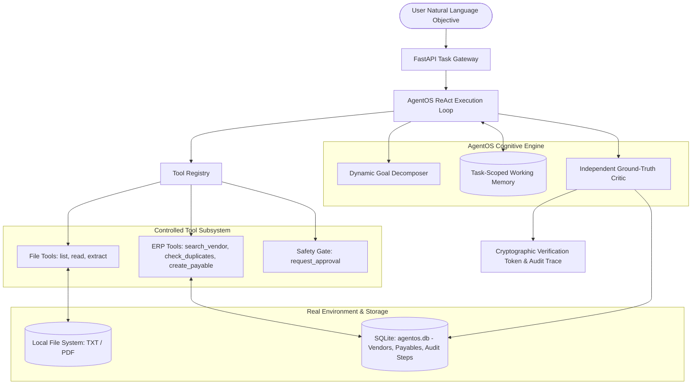
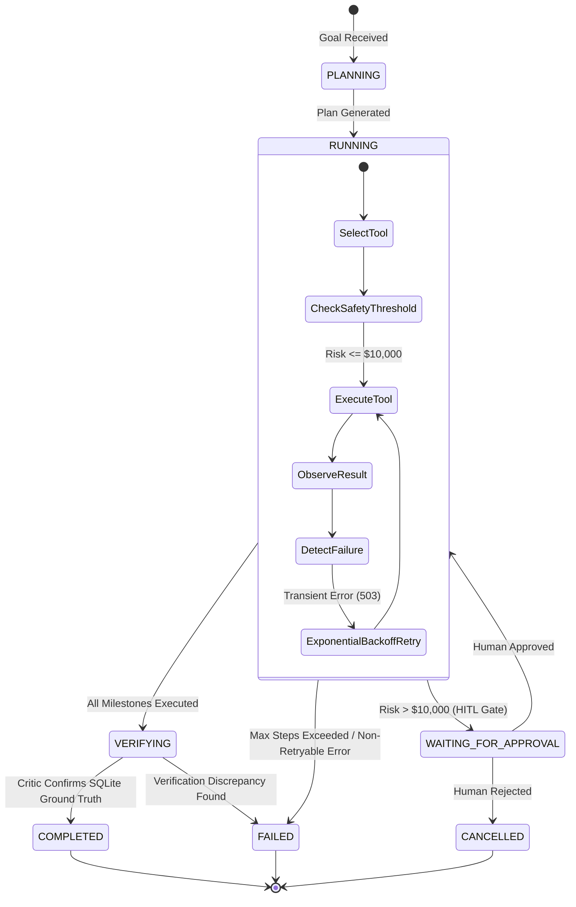
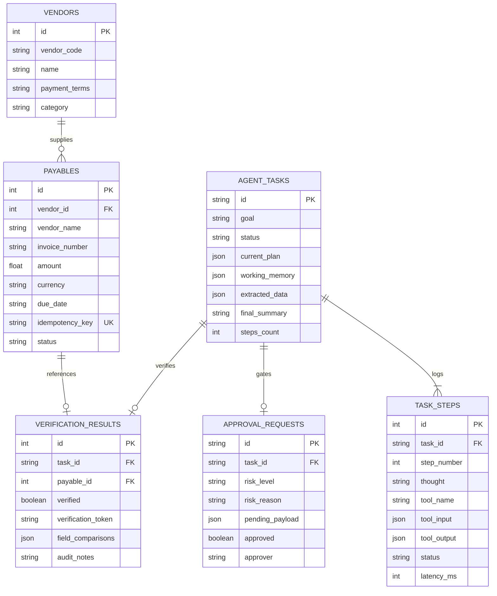

# AgentOS: Architecture & Technical Design Specification

> **System Name:** AgentOS — Autonomous AI Task Worker  
> **Tagline:** *"From instructions to verified outcomes."*  
> **Evaluation Focus:** Autonomy, Real Execution, Resilience, Independent Verification, Safety, Generalization

---

## 1. System Vision & Design Philosophy

Traditional workflow automation (RPA, static regex scripts) is brittle: any shift in document formatting or UI layout breaks the execution pipeline. Conversely, naive LLM wrapper prototypes suffer from hallucinations, fabricated actions, and no accountability—merely printing *"Task completed!"* without mutating or verifying underlying enterprise databases.

**AgentOS** bridges this gap as an autonomous AI employee engineered around five fundamental design tenets:

1. **Goal-Driven Autonomy:** The user specifies *what* to achieve in natural language (e.g., *"Find the latest invoice from Acme Technologies, extract the amount and due date, enter it into our internal system, and tell me once it is done"*). AgentOS determines the intermediate milestones, discovers files, compares version timestamps, and selects tools dynamically.
2. **Real World Execution:** AgentOS does not simulate actions. It reads actual filesystem documents (raw `.txt` and binary `.pdf`), parses structured financial fields, interacts with relational database schemas, and mutates persistent state.
3. **Resilience & Self-Correction:** Transient infrastructure failures (e.g., HTTP 503 gateway outages, network timeouts) are intercepted by an automated failure detection engine that computes exponential backoff and injects recovery steps on the fly.
4. **Independent Ground-Truth Verification:** An action is never assumed successful because an LLM claims it succeeded. An independent critic queries the underlying relational database (SQLite), validates field-by-field matches against extracted source data, and generates a tamper-evident audit receipt.
5. **Deterministic Zero-Barrier Portability:** Out of the box, AgentOS runs without third-party API dependencies or paid subscription barriers via an intelligent deterministic provider fallback, while supporting real LLMs (Gemini, Claude, GPT-4) via a pluggable provider interface.

---

## 2. High-Level System Architecture



---

## 3. Execution Lifecycle & State Machine

Every task follows an explicit finite-state lifecycle persisted to the `agent_tasks` SQLite table:



---

## 4. Core Subsystems & Deep Dive

### 4.1 Dynamic Goal Decomposer & Planner (`backend/app/agent/planner.py`)
- Analyzes unstructured natural language prompts to detect task intent (e.g. invoice processing, duplicate checking, multi-vendor resolution).
- Produces an initial structured plan of milestones:
  - Step 1: Discover candidate vendor files
  - Step 2: Read and determine latest version
  - Step 3: Extract structured financial entities
  - Step 4: Resolve canonical vendor entity
  - Step 5: Verify idempotency / check duplicates
  - Step 6: Create payable record
  - Step 7: Independently verify outcome
- Supports dynamic recovery mutation: if a transient error or schema anomaly is observed during step execution, the planner injects recovery milestones into `task.current_plan` on the fly.

### 4.2 ReAct Execution Loop & Working Memory (`backend/app/agent/loop.py`, `memory.py`)
- Implements the Reasoning + Action + Observation cycle.
- Step Limits: strictly constrained to a maximum of 15 steps (`max_steps=15`) to prevent runaway loops or infinite recursion.
- Working Memory tracks:
  - Cumulative observations from prior steps
  - Extracted financial attributes (`invoice_number`, `amount`, `due_date`, `currency`, `po_number`)
  - Target system IDs (`vendor_id`, `payable_id`)
  - Human approval state (`approval_resolved: bool`)

### 4.3 Controlled Tool Registry & Idempotency Layer (`backend/app/tools/`)
All tools inherit from `ControlledBaseTool` and return typed `ToolResult` objects:
```python
class ToolResult(BaseModel):
    success: bool
    data: Optional[Dict[str, Any]] = None
    error: Optional[str] = None
    retryable: bool = False
    execution_duration_ms: int = 0
```

#### Registered Tools:
1. `list_invoice_files`: Scans directory, parses filenames, extracts date hints, identifies latest invoices.
2. `read_invoice`: Reads text and real binary `.pdf` files (via `pypdf`), handles multi-line layout formatting.
3. `extract_invoice_fields`: Extracts invoice number, total amount, due date, vendor, PO number.
4. `search_vendor`: Queries SQLite database to resolve vendor name or aliases to canonical vendor record.
5. `search_existing_invoice`: Queries database for existing records by `(vendor_name, invoice_number)` to guarantee **idempotency**.
6. `create_payable`: Writes record to `payables` SQLite table with unique constraint and idempotency hash.
7. `get_payable`: Retrieves persisted payable record by ID.
8. `verify_payable`: Triggers ground-truth critic to validate database record against extracted source data.
9. `request_approval`: Emits an approval ticket when operation exceeds safety risk thresholds.
10. `report_task_result`: Synthesizes final execution evidence and outputs structured summary.

### 4.4 Multi-Layered Idempotency Protection
Financial double-payment is a severe real-world failure mode. AgentOS prevents duplicates at three independent layers:
1. **Agent Level:** The execution loop calls `search_existing_invoice` before attempting creation.
2. **Application Level:** A deterministic `idempotency_key` is computed as `SHA-256(vendor_name + invoice_number + amount)`.
3. **Database Level:** The SQLite schema enforces a composite unique constraint:
   ```sql
   UNIQUE(vendor_name, invoice_number)
   UNIQUE(idempotency_key)
   ```

### 4.5 Self-Correction & Failure Detection Engine
- Intercepts exceptions and tool-level errors.
- Classifies failures into:
  - **`TRANSIENT` (e.g. 503 Service Unavailable, connection drop):** Computes exponential backoff delay `0.5s * (2 ** retry_count)`. The agent updates step status to `RETRYING`, executes the retry milestone, and transitions step to `RECOVERED`.
  - **`PERMANENT` (e.g. missing required field, non-existent file):** Refuses to hallucinate fake data, logs exact diagnostic reasoning, and halts safely with `FAILED` state.

### 4.6 Human-in-the-Loop Safety Gate (HITL)
- Built-in risk evaluator intercepts all write operations.
- Rule: If `amount > 10,000.00 USD` and `auto_approve_high_risk` is `False`, the agent enters `WAITING_FOR_APPROVAL`.
- Creates a structured `ApprovalRequest` record containing:
  - `risk_level`: `HIGH`
  - `risk_reason`: `"Invoice amount $48,500.00 exceeds $10,000.00 threshold."`
  - `pending_payload`: Complete field diff.
- A human supervisor reviews the request in the React Web Modal or Terminal CLI prompt.
- Resumes execution only after cryptographic or authenticated approver sign-off.

### 4.7 Independent Ground-Truth Critic (`backend/app/verification/verifier.py`)
- Standard LLM agents evaluate themselves by hallucinating success statements.
- AgentOS decouples execution from verification:
  - An independent `GroundTruthVerifier` queries SQLite directly using raw SQL / SQLAlchemy.
  - Compares persisted database columns against extracted source document fields:
    - Vendor Name Match: `Extracted == Persisted`
    - Invoice Number Match: `Extracted == Persisted`
    - Amount Match: `abs(Extracted - Persisted) < 0.01`
    - Due Date Match: `Extracted == Persisted`
  - Produces a tamper-evident `VerificationResult` containing a unique verification token (`verif_...`), timestamp, and boolean verdict.

---

## 5. Database Schema (`agentos.db`)

The SQLite database implements full relational integrity with foreign keys enabled:



---

## 6. Zero-Setup Evaluation Harness

To ensure reviewers can immediately evaluate AgentOS without API keys or cloud configuration:
- `backend/app/agent/provider.py` implements `DeterministicFallbackProvider`.
- Covers 10 comprehensive evaluation scenarios:
  1. Standard Acme Primary Workflow
  2. Alternative Goal Phrasing ("Newest invoice Acme register payable")
  3. Transient 503 Gateway Outage with Exponential Backoff Recovery
  4. High-Value ($48.5k) Human-in-the-Loop Approval Authorization
  5. High-Value Human Rejection Safety Halt
  6. Idempotency & Duplicate Prevention (`INV-2023-042`)
  7. Missing Required Field Safety Halt (`INV-2024-002`)
  8. Ambiguous Vendor Disambiguation
  9. Maximum Step Limit Enforcement
  10. Binary PDF Parsing & Processing
- The test harness (`evaluation/run_evaluation.py`) executes all 10 scenarios against the SQLite database, validating a **100% scenario pass rate**, **0 false successes**, and **0 duplicate entries**.
